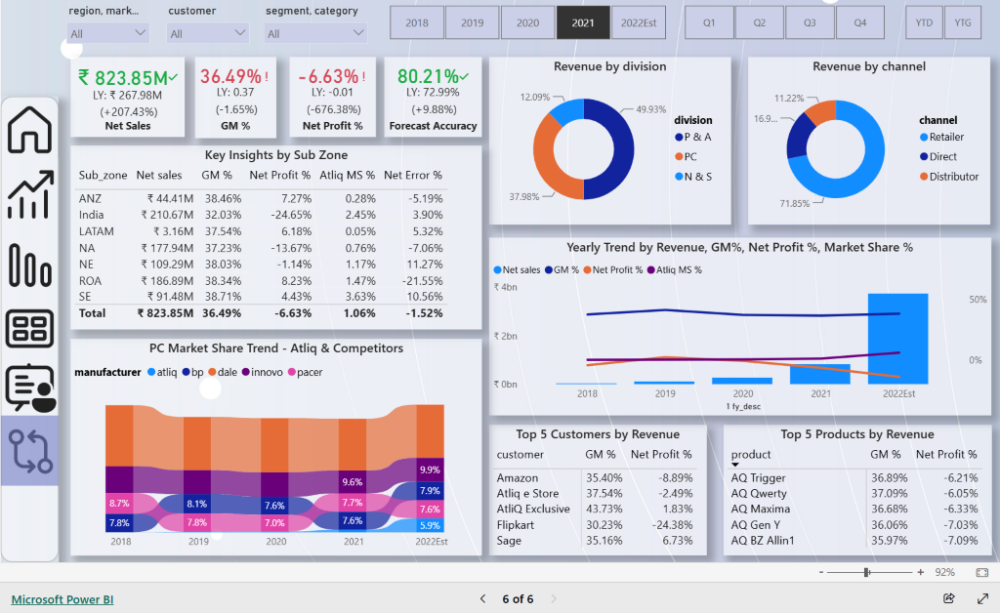
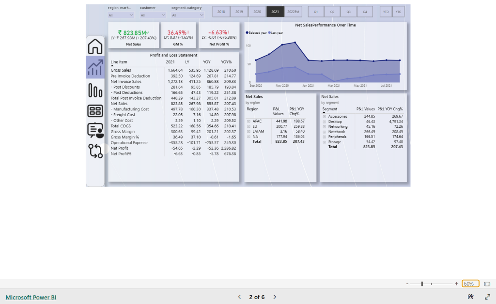
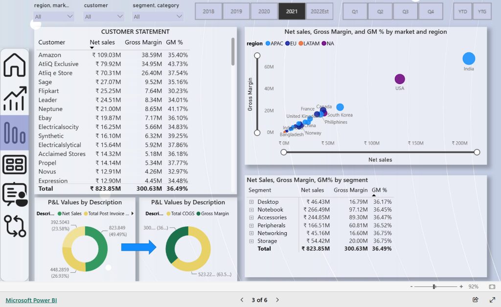
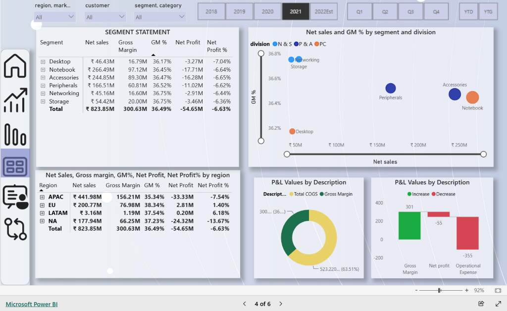
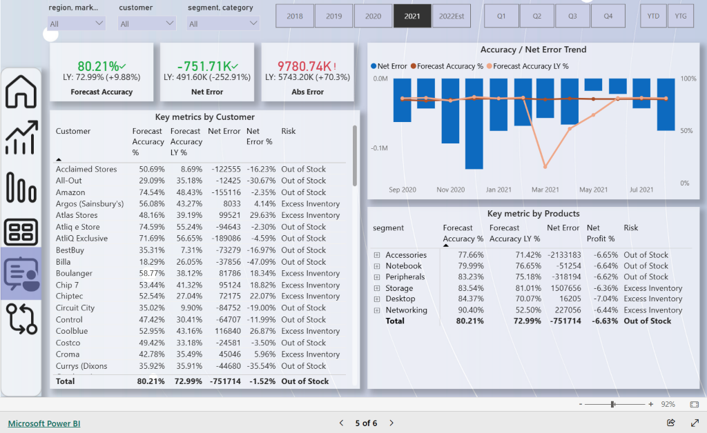
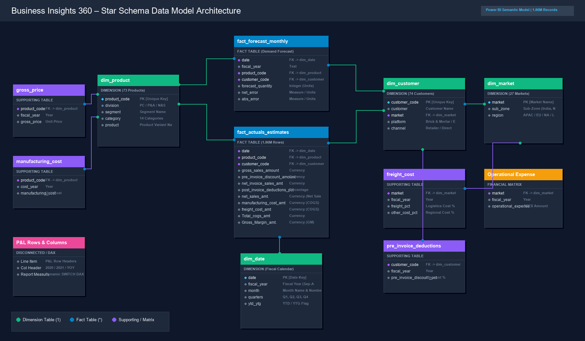

# 📊 Business Insights 360 – Enterprise Power BI Analytics Dashboard

[](https://app.powerbi.com/view?r=eyJrIjoiNTJjZTc0MmUtOThiMy00NzU3LWEzOWQtNWY2NDUyM2FkYzAyIiwidCI6IjUxMzRkZDExLWZlNDEtNGY3My1iODIyLTg0NDljN2Y1MzA4MCJ9)


An interactive, enterprise-grade **Power BI Business Intelligence & Executive Analytics Solution** engineered to evaluate cross-functional performance across **Finance, Sales, Marketing, and Supply Chain** for **AtliQ Hardware**—a global consumer electronics manufacturer operating across **27 markets**, **74 key customers**, and **1.86M+ transactional records**.

> 🔗 **Live Interactive Report**: [Click here to view the live published dashboard](https://app.powerbi.com/view?r=eyJrIjoiNTJjZTc0MmUtOThiMy00NzU3LWEzOWQtNWY2NDUyM2FkYzAyIiwidCI6IjUxMzRkZDExLWZlNDEtNGY3My1iODIyLTg0NDljN2Y1MzA4MCJ9)

---

## 📌 Business Problem & Objectives

### The Business Context
AtliQ Hardware experienced aggressive global expansion across **APAC, EU, North America, and LATAM**. However, as operations scaled, executive leadership faced severe commercial blind spots due to departmental reporting fragmentation:
1. **Reporting Silos & Excel Scalability Limits:** Finance, Sales, Marketing, and Supply Chain teams operated on separate, static Excel spreadsheets. Generating monthly reports took days, numbers frequently conflicted, and spreadsheets crashed under high data volumes.
2. **Hidden Losses Behind Explosive Top-Line Growth:** While top-line Net Sales grew **+207.4% YoY** (reaching $823.85M in FY21), bottom-line profitability collapsed into a **-$54.65M net loss** due to uncoordinated pricing, heavy promotional deductions, and skyrocketing operating expenses.
3. **Supply Chain Bullwhip Effect:** Low demand forecast accuracy and high net forecast errors created costly supply-demand mismatches: severe stockouts of top-selling PC lines alongside millions of dollars in locked-up capital from overstocked peripheral accessories.

### The Analytical Solution
This end-to-end Power BI reporting system was engineered to deliver transparent, data-driven visibility across five specialized departments:
* **Executive Strategic Cockpit:** High-level C-Suite KPI dashboard benchmarking revenue, Gross Margin %, Net Profit %, PC Market Share against global competitors (Dell, HP, Lenovo), and Top 5 Customers/Products.
* **Dynamic P&L Financial Statement:** Matrix P&L statement utilizing disconnected supporting tables and dynamic DAX format strings with full drill-down capabilities across Fiscal Years, Quarters, Markets, and Product Categories.
* **Sales Performance & Customer Matrix:** Customer performance scatter plots benchmarking Net Sales vs. Gross Margin % to isolate high-volume/unprofitable accounts and trace pre/post-invoice deduction leakage.
* **Marketing Profitability Breakdown:** Segment and regional P&L matrix paired with waterfall margin erosion analysis to pinpoint where profit evaporates from Gross Sales to Net Profit.
* **Supply Chain & Demand Planning Engine:** Forecast Accuracy %, Net Error, and Absolute Error tracking by customer and product, automatically risk-profiling accounts into *Out of Stock Risk* vs. *Excess Inventory Risk*.

---

## 🖼️ Dashboard Preview

| Executive View (C-Suite Strategic Cockpit) | Finance View (Dynamic P&L & Monthly Trend) |
| :---: | :---: |
|  |  |

| Sales View (Customer Performance & Matrix) | Marketing View (Segment & Regional Profitability) |
| :---: | :---: |
|  |  |

| Supply Chain View (Forecast Accuracy & Risk Profile) | Star Schema Data Model Architecture |
| :---: | :---: |
|  |  |

---

## 📈 Key Performance Indicators (KPI Summary)

### 1. Overall Financial Performance (FY 2020 vs. FY 2021 Real Actuals)

| Financial Metric | Measure Name | FY 2020 (Benchmark) | FY 2021 (Latest Real) | YoY Change ($) | YoY Growth (%) |
| :--- | :--- | :---: | :---: | :---: | :---: |
| **Gross Sales** | `SUM(gross_sales_amount)` | **$535.95M** | **$1,664.64M** | +$1,128.69M | **+210.60%** |
| **Pre-Invoice Deductions** | `[Pre Invoice Deduction]` | $124.69M | $392.50M | +$267.81M | +214.77% |
| **Net Invoice Sales** | `[Net Invoice Sales]` | $411.25M | $1,272.13M | +$860.88M | +209.33% |
| **Post-Invoice Deductions** | `[Total Post Invoice Deduction]` | $143.27M | $448.29M | +$305.02M | +212.89% |
| **Net Sales** | `[Net sales]` | **$267.98M** | **$823.85M** | +$555.87M | **+207.43%** |
| **Manufacturing Cost** | `[Manufacturing Cost]` | $160.30M | $497.78M | +$337.48M | +210.53% |
| **Freight Cost** | `[Freight Cost]` | $7.16M | $22.05M | +$14.89M | +207.98% |
| **Total COGS** | `[Total COGS]` | $168.56M | $523.22M | +$354.66M | +210.41% |
| **Gross Margin (GM)** | `[Gross Margin]` | **$99.42M** | **$300.63M** | +$201.21M | **+202.37%** |
| **Gross Margin % (GM %)** | `[GM %]` | **37.10%** | **36.49%** | -0.61% | **-1.65%** |
| **Operational Expenses** | `[Operational Expense]` | **$101.71M** | **$355.28M** | +$253.57M | **+249.30%** |
| **Net Profit** | `[Net Profit]` | **-$2.29M** | **-$54.65M** | -$52.36M | **Loss Widened** |
| **Net Profit %** | `[Net Profit %]` | **-0.85%** | **-6.63%** | -5.78% | **-676.38%** |

---

### 2. Channel Distribution Dynamics (FY 2021)

| Channel | Net Sales ($M) | Revenue Share (%) | Gross Margin (%) | Net Profit ($M) | Net Profit Margin (%) | Commercial Assessment |
| :--- | :---: | :---: | :---: | :---: | :---: | :--- |
| **Retailer** | **$591.97M** | **71.85%** | 35.29% | **-$65.06M** | **-10.99%** | High volume, but heavy discount erosion drives loss |
| **Direct (AtliQ Stores)**| **$139.46M** | **16.93%** | **41.78%** | **+$2.75M** | **+1.97%** | **+6.5% higher GM%**, protected pricing & profitable |
| **Distributor** | **$92.42M** | **11.22%** | 36.23% | **+$7.62M** | **+8.25%** | Highest net margin contribution |

---

### 3. Supply Chain & Demand Planning Metrics

| Metric | Measure Name | FY 2020 | FY 2021 | YoY Shift | Operational Impact |
| :--- | :--- | :---: | :---: | :---: | :--- |
| **Forecast Accuracy %** | `[Forecast Accuracy %]` | **72.99%** | **80.21%** | **+7.22%** | Improved forecasting baseline |
| **Forecasted Volume** | `SUM(forecast_quantity)` | 21.26M units | 49.41M units | **+132.4%** | Rapid volume ramp-up |
| **Net Error (Units)** | `[Net Error]` | +491.60K | **-751.71K** | Shift to negative | Under-forecasting shifted to over-forecasting |
| **Absolute Error (Units)** | `[abs error]` | 5.74M units | **9.78M units** | **+70.30%** | **+4.04M units of physical inventory variance** |

---

### 4. Top 5 Customer Performance (Executive View)

| Customer | Channel | Net Sales ($M) | Gross Margin (%) | Net Profit Margin (%) | Strategic Status |
| :--- | :--- | :---: | :---: | :---: | :--- |
| **Amazon** | Retailer | **$109.03M** | 35.40% | **-8.89%** | Loss leader; excessive promotional deductions |
| **AtliQ Exclusive** | Direct | **$79.92M** | **43.73%** | **+1.83%** | **Highest GM% among top accounts & profitable** |
| **Atliq e Store** | Direct | **$70.31M** | 37.54% | -2.49% | E-commerce channel scaling |
| **Sage** | Retailer | **$27.07M** | 35.16% | **+6.73%** | Strong regional profitability |
| **Flipkart** | Retailer | **$25.25M** | 30.23% | **-24.38%** | Severe margin loss; urgent discount renegotiation needed |

---

## 🔍 Deep Analytical Insights

### 1. Revenue Boom vs. Profit Collapse (Finance View)
* **The Finding:** While Net Sales surged **207.4% YoY** (reaching $823.85M in FY21), bottom-line profitability collapsed into a **-$54.65M net loss**.
* **The Root Causes:**
  1. **Disproportionate Deductions:** Customer discounts and deductions surged by +213.7% to **$840.79M**, consuming **50.5% of total Gross Sales**.
  2. **Surging Operating Expenses:** Operational overhead scaled faster than margin contribution, spiking **+249.3% YoY** (from $101.71M to $355.28M) to fund rapid international expansion.
  3. **COGS Inflation:** Freight costs tripled (+207.98% to $22.05M) alongside manufacturing cost inflation (+210.53% to $497.78M).
* **Strategic Recommendation:** Establish strict discount governance tiers on high-volume accounts and enforce regional OPEX budget caps tied directly to gross margin contribution.

---

### 2. The Supply Chain Paradox (Supply Chain View)
* **The Finding:** Forecast Accuracy improved by **7.2 percentage points (73.0% to 80.2%)**, but **Absolute Unit Error surged 70.3% (from 5.7M to 9.8M units)**.
* **The Mechanism:** Because overall shipment volumes expanded by **+132.4%** (from 21.3M to 49.4M units), a higher percentage accuracy still translated into **4.04 million more misforecasted physical units** in the distribution pipeline.
* **Risk Categorization:**
  * **Out of Stock Risk:** Net Error in Accessories (-2.13M units) and Peripherals (-318K units) caused delayed order fulfillment and lost retail revenue.
  * **Excess Inventory Risk:** Net Error in Storage (+1.51M units) created severe warehousing surcharges and working capital lockup.
* **Strategic Recommendation:** Shift demand planning from monthly static forecasts to weekly rolling consensus forecasts, integrating live retailer POS data from key accounts like Amazon and Flipkart.

---

### 3. Channel & Regional Profit Disparities (Sales & Executive Views)
* **The Finding:** The **Retailer channel** drove **71.85% of total revenue ($592.0M)**, but incurred an **-11.0% net loss**, whereas the **Direct channel** delivered a **+6.5% higher Gross Margin (41.8% vs. 35.3%)** and stayed net profitable (+1.97%).
* **Regional Divergence:**
  * **North America:** Generated $177.94M in revenue but suffered the worst regional profit collapse (**-13.67% net profit margin**, -$24.32M loss).
  * **India:** Delivered the highest single market revenue ($210.67M) but ran at a **-24.65% net loss** due to aggressive price-matching against domestic competitors.
  * **Europe:** Delivered $200.77M in revenue with disciplined promotional spend, remaining **net profitable (+1.40% margin, +$2.81M)**.

---

## 🏗️ Data Architecture & Star Schema Model

The semantic model follows an optimized **Star Schema** architecture managing **1,858,329 fact rows**:


### Model Structure Overview:
* **Central Fact Tables:**
  * `fact_actuals_estimates` (1.86M rows): Transactional sales actuals, invoice adjustments, COGS components, and gross margins.
  * `fact_forecast_monthly`: Customer- and product-level monthly demand forecasts.
* **Dimension Tables:**
  * `dim_customer`: 74 customers with platform and channel classifications.
  * `dim_product`: 73 products grouped across 14 categories and 3 divisions (PC, Peripherals & Accessories, Network & Storage).
  * `dim_market`: 27 geographical markets across 4 regions (APAC, EU, NA, LATAM).
  * `dim_date`: Custom fiscal calendar (AtliQ fiscal year: September to August).
* **Supporting & Calculation Tables:**
  * `P&L Rows` & `P & L Columns`: Disconnected tables powering the dynamic matrix P&L structure.
  * `Operational Expense`, `freight_cost`, `gross_price`, `manufacturing_cost`, `marketshare`, `NsGmTarget`.

---

## 🧠 Key DAX Measures Implemented

> 📖 **Complete DAX Formula Repository**: [Click here to view the full catalog of all 30+ documented DAX measures with formulas, logic explanations, and return types in DAX_Measures.md](DAX_Measures.md)

The semantic model contains **30+ custom DAX measures**:

### 1. Dynamic P&L Row Switcher (Matrix Formulation)
```dax
P&L Values = 
VAR _SelectedLineItem = SELECTEDVALUE('P&L Rows'[Line Item])
RETURN
SWITCH(
    TRUE(),
    _SelectedLineItem = "Gross Sales", [Gross Sales],
    _SelectedLineItem = "Pre Invoice Deduction", [Pre Invoice Deduction],
    _SelectedLineItem = "Net Invoice Sales", [Net Invoice Sales],
    _SelectedLineItem = "Net Sales", [Net sales],
    _SelectedLineItem = "Manufacturing Cost", [Manufacturing Cost],
    _SelectedLineItem = "Freight Cost", [Freight Cost],
    _SelectedLineItem = "Total COGS", [Total COGS],
    _SelectedLineItem = "Gross Margin", [Gross Margin],
    _SelectedLineItem = "Gross Margin %", [GM %],
    _SelectedLineItem = "Operational Expense", [Operational Expense],
    _SelectedLineItem = "Net Profit", [Net Profit],
    _SelectedLineItem = "Net Profit%", [Net Profit %],
    [Net sales]
)
```

### 2. Time Intelligence (Fiscal Year Last Year Benchmark)
```dax
Net Sales LY = 
CALCULATE(
    [Net sales],
    SAMEPERIODLASTYEAR(dim_date[date])
)
```

### 3. Supply Chain Risk Classification
```dax
Risk = 
SWITCH(
    TRUE(),
    [Net Error] < 0, "Out of Stock",
    [Net Error] > 0, "Excess Inventory",
    "Balanced"
)
```

### 4. Dynamic Performance Chart Title
```dax
Performance Visual Title = 
VAR _Selected = SELECTEDVALUE('P&L Rows'[Line Item], "Net Sales")
RETURN
_Selected & " Performance Trend (vs. LY)"
```

---

## 🚀 How to Run the Project Locally

### Prerequisites
* **Power BI Desktop** (August 2023 or newer recommended).
* **Git & Git LFS** (required to clone large files over 100 MB).

### Steps
1. Clone the repository using Git LFS:
   ```bash
   git lfs install
   git clone https://github.com/Curious011/Business-Insights-360-.git
   cd Business-Insights-360-
   ```
2. Open **`Business_Insights_360.pbix`** in Power BI Desktop.
3. Explore the dashboard using the interactive navigation buttons on the **Home** view.

> **Interactive Web Access:** You can also explore the fully interactive report directly in your browser without installing Power BI Desktop:  
> [View Live Power BI Dashboard](https://app.powerbi.com/view?r=eyJrIjoiNTJjZTc0MmUtOThiMy00NzU3LWEzOWQtNWY2NDUyM2FkYzAyIiwidCI6IjUxMzRkZDExLWZlNDEtNGY3My1iODIyLTg0NDljN2Y1MzA4MCJ9)

---

## 👨‍💻 Author
* **LinkedIn:** [Your LinkedIn Profile](https://www.linkedin.com)
* **GitHub:** [@Curious011](https://github.com/Curious011)

*Feel free to star ⭐ this repository if you found it valuable!*
